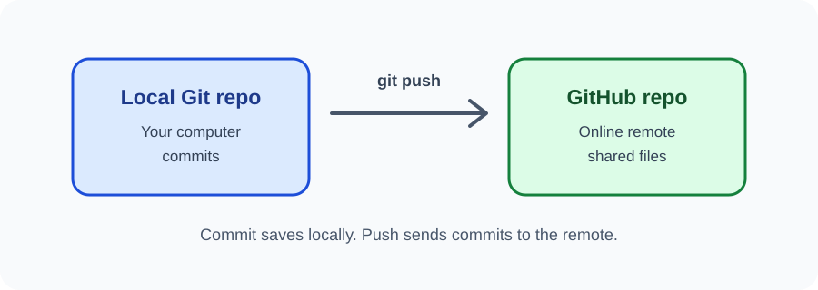

# Day 33 Lecture Notes — GitHub Remote Repositories

## 1. What is a remote?
A remote is a named connection to another copy of a Git repository, often hosted online. A common remote name is origin.

## 2. Create a GitHub account
1. Open [github.com](https://github.com).
2. Sign up using your own email and a strong unique password.
3. Complete any verification steps yourself.
4. Keep recovery information private.
5. Never share passwords or one-time codes with classmates or instructors.

Follow current GitHub age and account requirements. If you cannot create an account, complete the instructor's alternative practice using a demonstration repository.

## 3. Create a repository on GitHub
1. Sign in.
2. Choose New repository.
3. Enter a clear name such as practice-website.
4. Choose Public only if your instructor confirms the content is safe to publish.
5. For a beginner push from an existing local project, create an empty repository without adding a README, licence, or .gitignore on GitHub. This avoids an unrelated initial history.

## 4. Connect your local repository
Copy the HTTPS repository address from GitHub. Replace the example URL with your own:

~~~bash
git remote add origin https://github.com/USERNAME/REPOSITORY.git
~~~

Check the remote:

~~~bash
git remote -v
~~~

If origin already exists, do not add it again.

## 5. Push the project
~~~bash
git branch -M main
git push -u origin main
~~~

The first push may ask you to authenticate. Use the approved browser/device flow or Git Credential Manager. GitHub does not accept account passwords as Git HTTPS authentication. Never put a password or token directly in the command.

## 6. Verify the result
Open the repository page in your browser. Confirm that index.html, CSS, JavaScript, and images appear. The repository is now online, but it is not automatically a published website.

## 7. Future updates
After changing files, use the local workflow:

~~~bash
git status
git add .
git commit -m "Update website content"
git push
~~~

The push sends new local commits to the remote repository.

## 8. Public repository safety
Before pushing, inspect files. Do not upload passwords, API keys, private keys, private contact lists, student records, or confidential material. A public repository can be viewed and copied by anyone.

## 9. Review
1. What is a remote repository?
2. What is the common name for the main remote?
3. Which command sends local commits to GitHub?
4. Does pushing automatically publish a website?
5. What should never be uploaded to a public repository?
