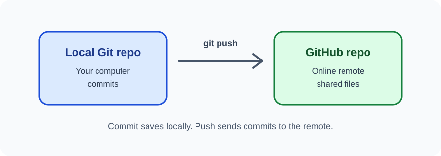

# Day 33 Practical Exercises — Publish a Repository

## Exercise 1 — Prepare the local project
Open your Git project. Run git status and confirm your latest work is committed.

## Exercise 2 — Create an online repository
Sign in to GitHub and create a repository named practice-website. For this guided workflow, leave it empty when creating it.

## Exercise 3 — Add the remote
Copy your repository's HTTPS URL and use it in place of the sample:

~~~bash
git remote add origin https://github.com/USERNAME/REPOSITORY.git
git remote -v
~~~

If origin already exists, stop and ask the instructor to inspect it.

## Exercise 4 — Push
~~~bash
git branch -M main
git push -u origin main
~~~

Complete authentication through the browser/device flow or credential manager.

## Exercise 5 — Verify online
Open the GitHub repository page. Check that your project files are present.

## Required independent task
Change one heading, commit the change, push again, and refresh the GitHub page to confirm the update.

## Checklist
- [ ] I created or accessed my own account.
- [ ] I created a repository.
- [ ] I checked the remote URL.
- [ ] I pushed the main branch.
- [ ] I can see my files online.
- [ ] I know commit and push are different.

## Safety
Never share your password, recovery code, or token. Do not upload private data.
