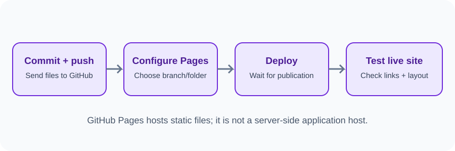
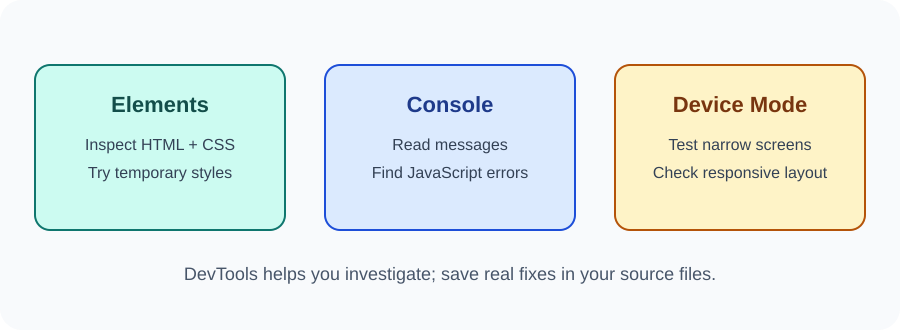

# Day 34 Instructor Guide — Pages and Testing

## Preparation
Use a simple repository with index.html at the root. Confirm Pages is available for the demonstration repository. Prepare a working published URL. Check the latest GitHub Pages settings interface.

## Outcomes
Students publish a static site and run a short browser test using DevTools.

## 120-minute plan
| Time | Activity |
|---|---|
| 0–20 min | Explain static hosting and quality testing |
| 20–24 min | Review GitHub push workflow |
| 24–54 min | Demonstrate Pages settings, publication, DevTools |
| 54–116 min | Students deploy and test |
| 116–120 min | Review results |

## Demonstration
1. Open the repository and verify index.html is at the root.
2. Open Settings → Pages.
3. Select the main branch and root folder as source.
4. Save and explain that deployment may take time.
5. Open the published URL.
6. Inspect a heading in Elements.
7. Show the Console and explain how errors appear.
8. Enable Device Mode and test a narrow width.
9. Make a small fix locally, commit, push, and re-test.

## Visual aids
Use images/day-34-pages-workflow.svg and images/day-34-devtools-panels.svg.

## Questions
- Is GitHub Pages a backend server?
- Why might CSS fail to load after deployment?
- Do temporary Elements panel changes edit your project files?
- What should you test after publishing?

## Common errors
- Pages source wrong: check branch and folder.
- No index page: add or move index.html to the chosen publishing folder.
- CSS path incorrect: check relative path and exact capitalization.
- Deployment pending: wait and refresh the Pages status; do not promise instant publication.
- Console error: read the message and line before changing code.

## Differentiation
Support: students can deploy a supplied instructor project if their repository setup is incomplete. Extension: test keyboard navigation and image alt text.

## Checkpoint
Each student opens a published URL or demonstrates the instructor-provided deployment, then shows a mobile-width test and Console check.
