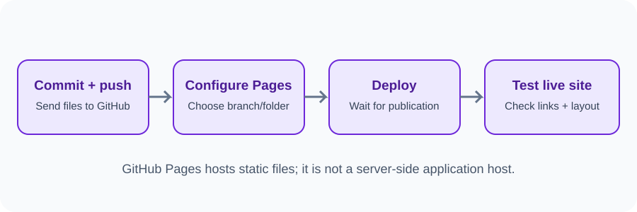
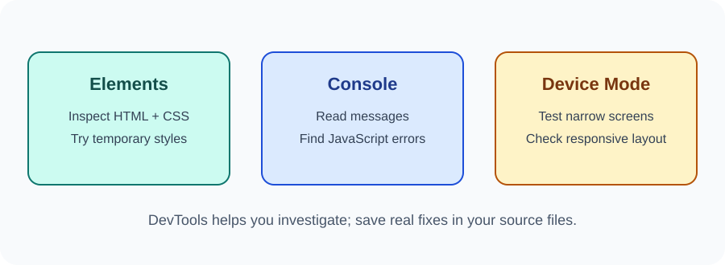

# Day 34 Lecture Notes — Publish and Test a Website

## 1. What is GitHub Pages?
GitHub Pages can publish a static website from a GitHub repository. Static files include HTML, CSS, JavaScript, and images.

GitHub Pages does not run a Node.js backend, server-side application, or database.

## 2. Prepare the project
Check that:
- The website has an index.html file in the selected publishing folder.
- CSS and JavaScript links use correct relative paths.
- Images exist and paths are correct.
- The latest changes have been committed and pushed.
- No secrets or private data are in the repository.

## 3. Enable GitHub Pages
1. Open your repository on GitHub.
2. Select Settings.
3. Find Pages in the repository settings.
4. Under Build and deployment, choose Deploy from a branch if available.
5. Select the main branch and the root folder (/) for this lesson.
6. Save the settings.
7. Wait for the site to publish, then open the URL shown in Pages settings.

The exact interface may change. Follow the current GitHub Docs if the labels differ.

## 4. Test the published website
Check:
- Does the page open?
- Does the title and main heading appear?
- Do CSS styles load?
- Do images load?
- Do navigation links work?
- Do JavaScript interactions work?
- Does the layout fit a narrow screen?

## 5. Open Chrome DevTools
Use one of these methods:
- Right-click a page element and choose Inspect.
- Press F12 or Ctrl+Shift+I on Windows.
- Open Chrome menu → More tools → Developer tools.

## 6. Elements panel
Use Elements to inspect page HTML and CSS. You can temporarily change styles to experiment. These temporary edits do not change your source files.

## 7. Console panel
Use Console to read JavaScript errors and messages. A red error can help identify a problem. Read the first error carefully and check the file and line it reports.

## 8. Device Mode
Use the device toolbar in DevTools to test a narrow viewport. Try a phone-sized width and a wider desktop view. This is a useful check, not a guarantee that every real device behaves exactly the same.

## 9. Simple testing checklist
1. Open the published URL.
2. Refresh the page.
3. Click each navigation link.
4. Test each button or interaction.
5. Check images and CSS.
6. Test narrow and wide layouts.
7. Look for Console errors.
8. Fix problems in VS Code, commit, push, and re-test.

## 10. Common problems
- 404 or missing page: check index.html and publishing folder.
- Old version appears: confirm the latest commit was pushed and allow deployment time.
- Missing CSS: check stylesheet path and file name case.
- Missing image: check the image path and exact file name.
- JavaScript error: inspect Console and check selectors and syntax.
- Page is not responsive: check viewport meta tag, flexible layout, and media queries.

## 11. Review
1. What kind of website can GitHub Pages publish?
2. Where do you enable Pages?
3. What is the Elements panel used for?
4. What can the Console help you find?
5. Why should you test both narrow and wide screens?
