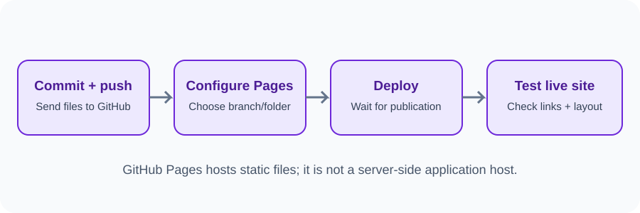
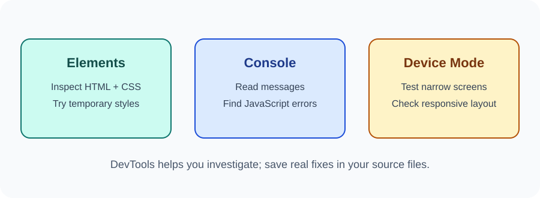

# Day 34 Practical Exercises — Deploy and Test

## Exercise 1 — Prepare your repository
Check that index.html is in the publishing folder and CSS/images use correct paths. Commit and push the latest version.

## Exercise 2 — Enable GitHub Pages
1. Open the repository.
2. Go to Settings → Pages.
3. Choose Deploy from a branch if offered.
4. Select main and /(root).
5. Save.
6. Wait for GitHub to show the published URL.

## Exercise 3 — Open the live site
Open the URL shown in Pages settings. Check the heading, CSS, images, and navigation.

## Exercise 4 — Inspect an element
Right-click a heading and choose Inspect. Find the selected element in Elements. Change a style temporarily and notice that it does not change your source file.

## Exercise 5 — Check Console
Open the Console. Look for errors. If there is an error, read the message and line number.

## Exercise 6 — Test a mobile width
Turn on Device Mode and choose a narrow viewport. Check for horizontal scrolling, clipped content, and difficult navigation.

## Required independent task
Complete this test record:

| Test | Pass / Needs fixing |
|---|---|
| Page opens | |
| CSS loads | |
| Images load | |
| Navigation works | |
| JavaScript interaction works | |
| Narrow layout works | |
| No unexplained Console errors | |

Fix at least one issue if you find one, then commit, push, and test again.

## Checklist
- [ ] Pages enabled.
- [ ] Published URL opened.
- [ ] Elements panel inspected.
- [ ] Console checked.
- [ ] Mobile and desktop widths tested.

## Optional challenge
Check keyboard focus and meaningful image alt text.
