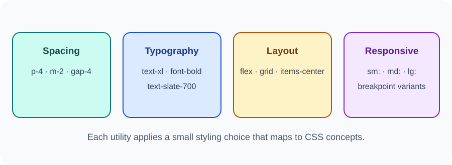

# Day 35 Instructor Guide — Tailwind Introduction

## Preparation
Use the official Tailwind CSS v4 Play CDN documentation. Test the classroom demo before the lesson. Do not use old v3 setup snippets. Keep a traditional CSS version available in case the CDN or network is unavailable.

## Outcomes
Students recognise utility-first styling and use a small selection of spacing, colour, typography, layout, and responsive utilities.

## 120-minute plan
| Time | Activity |
|---|---|
| 0–20 min | Explain utility-first CSS and compare with traditional CSS |
| 20–24 min | Review CSS fundamentals |
| 24–54 min | Demonstrate card, spacing, colours, Flexbox/Grid, responsive prefix |
| 54–116 min | Students build and customise one card or course section |
| 116–120 min | Review and explain optional use |

## Demonstration
1. Show a small card styled with normal CSS.
2. Show the equivalent utility classes.
3. Identify padding, background, text, radius, and shadow utilities.
4. Add a flex row and explain familiar alignment concepts.
5. Show a responsive grid with md:grid-cols-2.
6. Resize the browser and observe the layout.
7. Explain that Tailwind still produces CSS styling and does not replace HTML or JavaScript.

## Visual aid
Use images/day-35-tailwind-utilities.svg. Connect each group of utilities to CSS topics already taught.

## Questions
- Why is Tailwind called utility-first?
- What does p-4 represent?
- How is md:grid-cols-2 responsive?
- Why is the Play CDN not a production setup?

## Common errors
- Students treat class names as magic: ask them to explain the CSS effect.
- Network blocks CDN: use a prepared local screenshot or traditional CSS comparison.
- Too many utilities: focus on a small set and build one element at a time.
- Students assume Tailwind is required: remind them final projects can use normal CSS.

## Differentiation
Support: provide a starter card and a short utility reference. Extension: build a responsive two-card grid using utilities.

## Checkpoint
Students style a card and explain at least four utilities. End the week by asking each student to identify one Git skill and one deployment test they can now perform.
