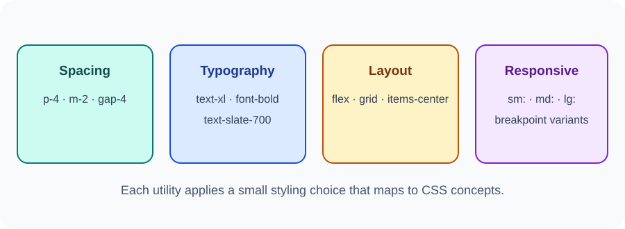

# Day 35 Lecture Notes — Tailwind CSS Introduction

## 1. What is Tailwind CSS?
Tailwind CSS is a utility-first CSS framework. Instead of writing a separate CSS rule for every small design choice, you combine utility classes in HTML to apply styles.

Traditional CSS:

~~~css
.card {
  padding: 1rem;
  border-radius: 0.75rem;
  background: white;
}
~~~

Tailwind-style utilities:

~~~html

  Course information

~~~

Both approaches can create a similar result. Tailwind does not remove the need to understand CSS.

## 2. Utility-first idea
A utility class usually represents one small styling choice, such as padding, text size, background colour, or display behaviour.

## 3. Spacing and sizing examples
- p-4: padding on all sides.
- px-4: horizontal padding.
- py-2: vertical padding.
- m-4: margin on all sides.
- w-full: full available width.
- max-w-xl: maximum width from the framework scale.

Spacing names and values follow Tailwind's current scale. Consult the current docs rather than memorising every value.

## 4. Text and colour examples
- text-xl: larger text size.
- font-bold: bold text.
- text-slate-700: text colour.
- bg-blue-600: background colour.
- rounded-lg: rounded corners.
- shadow: a shadow utility.

## 5. Flexbox and Grid utilities
~~~html

  Course
  <button>Explore</button>

~~~

~~~html

  <article>HTML</article>
  <article>CSS</article>

~~~

These utilities apply familiar Flexbox and Grid concepts that students already learned in CSS.

## 6. Responsive prefixes
Tailwind supports responsive variants such as sm:, md:, and lg:. A prefixed utility applies at that breakpoint and above.

~~~html

  ...

~~~

This creates one column by default and two columns at the md breakpoint and wider. Check current documentation for breakpoint details.

## 7. A simple card
~~~html
<article class="mx-auto max-w-sm rounded-xl bg-white p-6 shadow">
  <h2 class="text-xl font-bold text-slate-800">Web Development</h2>
  
Learn HTML, CSS and JavaScript.

  <a class="mt-4 inline-block rounded-lg bg-blue-600 px-4 py-2 text-white" href="#">
    Learn more
  </a>
</article>
~~~

## 8. Classroom setup with Play CDN
For a short demonstration, use the official Play CDN instructions: [tailwindcss.com/docs/installation/play-cdn](https://tailwindcss.com/docs/installation/play-cdn).

The current documentation provides the browser script for the Play CDN. Do not copy old Tailwind v3 CDN or configuration instructions. The Play CDN is a learning tool, not a production build setup.

## 9. Traditional CSS still matters
Tailwind classes map to CSS concepts. Students should still understand selectors, the box model, Flexbox, Grid, media queries, and accessibility. The final project may use normal CSS.

## 10. Common mistakes
- Thinking Tailwind replaces HTML or JavaScript.
- Adding many classes without understanding their purpose.
- Using responsive prefixes without testing screen widths.
- Copying outdated setup instructions from old tutorials.
- Using the Play CDN on a production website.

## 11. Review
1. What does utility-first mean?
2. Which class can add padding on all sides?
3. Which utilities can create a flex layout?
4. What does md: do?
5. Is the Play CDN recommended for production?
