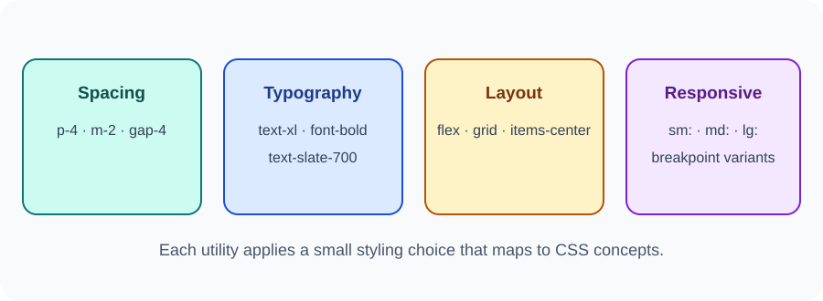

# Day 35 Practical Exercises — Tailwind Utilities

## Exercise 1 — Open the official documentation
Open the [Tailwind Play CDN guide](https://tailwindcss.com/docs/installation/play-cdn). Follow the current browser setup shown in the official documentation. Do not use old v3 instructions.

## Exercise 2 — Build a card
Create a card with a heading, paragraph, and link. Try utilities for:
- Padding: p-4 or p-6
- Background: bg-white
- Rounded corners: rounded-lg or rounded-xl
- Text: text-xl, font-bold, text-slate-700
- Shadow: shadow

## Exercise 3 — Add layout
Use flex, items-center, justify-between, and gap utilities to arrange two items in a row.

## Exercise 4 — Make a responsive grid
Try:

~~~html

  <article class="rounded-xl bg-white p-4">HTML</article>
  <article class="rounded-xl bg-white p-4">CSS</article>

~~~

Resize the browser and observe the change.

## Required independent task
Create a course information card with a heading, short description, and link. Explain the purpose of four utility classes.

## Checklist
- [ ] I can explain utility-first CSS.
- [ ] I used spacing and colour utilities.
- [ ] I used a layout utility.
- [ ] I tried a responsive prefix.
- [ ] I know normal CSS remains acceptable.

## Optional challenge
Create a two-card responsive grid and compare it with a version styled using your own CSS.

## Important
The Play CDN is only for classroom learning and development. Do not use it as the production setup for the final project.
