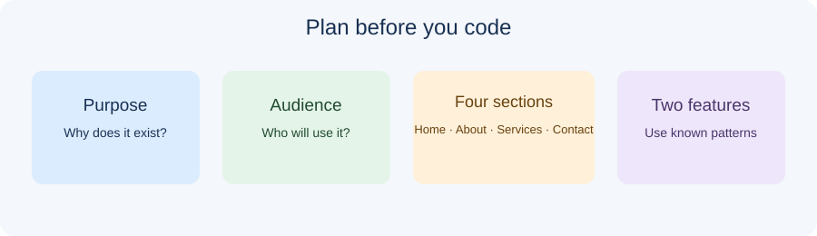

# Day 36 Lecture Notes — Final Project Planning and Wireframe

## Lesson purpose

Choose a realistic website topic, identify its audience, plan the four required sections, sketch a wireframe, and prepare the starter folder.

## 1. Keep the project achievable

The final project is an opportunity to combine skills already taught. It is not a competition to build the largest website. A clear single-page website with Home, About, Services or Courses, and Contact sections can meet the complete project requirement. Separate pages and extra features are optional extensions only.

## 2. Learning outcomes

- Choose a suitable topic and audience.
- Describe the purpose of Home, About, Services or Courses, and Contact sections.
- Sketch a readable desktop and mobile page layout.
- Select two familiar JavaScript interactions.
- Create and inspect the supplied starter project folder.

## 3. Core ideas

A project begins with a purpose and an audience. Students should decide who the website is for and what visitors should understand or do. A wireframe is a simple plan, not a finished design. It helps students decide the order of information before coding. Keep content short and use fictional details or information approved by the instructor.

## 4. Instructor demonstration

Use a fictional academy or small business. Show how one clear purpose, four sections, a short navigation list, and two familiar interactions are enough. Demonstrate the supplied starter folder and explain which files students will edit.

## 5. Practical workflow

1. Write a one-sentence purpose and identify the intended audience.
2. Plan a Home section with a heading, short introduction, and call to action.
3. Plan About, Services/Courses, and Contact content using short bullet points.
4. Draw a simple wireframe showing header, navigation, main sections, and footer.
5. Choose two interactions already practised, such as mobile navigation and FAQ show/hide.
6. Copy the instructor starter folder and open the folder in VS Code.

## 6. Common mistakes to watch for

- Students add optional features before finishing required work.
- File names or paths use different spelling or letter case.
- Navigation links do not match section IDs.
- Students test only on a desktop-sized screen.
- Students paste code without understanding or testing it.
- Students share passwords, tokens, private contact details, or other sensitive information.

## 7. Accessibility and privacy

Use descriptive link text, readable contrast, meaningful image alternatives, and buttons for actions. Keep interactive controls keyboard accessible. Use fictional project contact details. Never ask students to share passwords or access tokens. The starter contact form is a demonstration only unless a separate, approved service is configured.

## 8. References

- [MDN: Your first website](https://developer.mozilla.org/en-US/docs/Learn_web_development/Getting_started/Your_first_website)
- [W3C WAI: Tips for designing](https://www.w3.org/WAI/tips/designing/)
