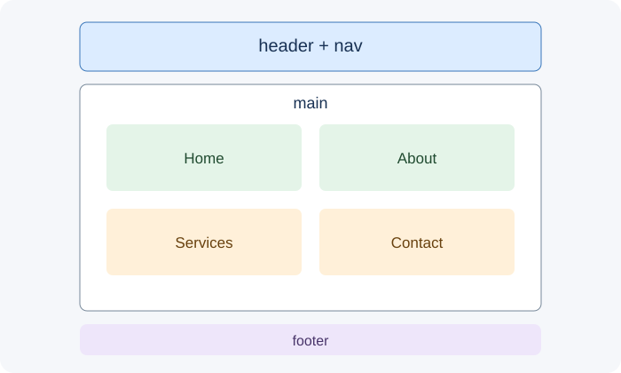

# Day 37 Lecture Notes — Build the HTML Structure and Content

## Lesson purpose

Turn the approved plan into a semantic single-page website with four sections, working navigation, headings, text, and accessible images.

## 1. Keep the project achievable

The final project is an opportunity to combine skills already taught. It is not a competition to build the largest website. A clear single-page website with Home, About, Services or Courses, and Contact sections can meet the complete project requirement. Separate pages and extra features are optional extensions only.

## 2. Learning outcomes

- Create semantic page regions using header, nav, main, section, and footer.
- Build four clearly identified content sections.
- Connect navigation links to section IDs.
- Use heading levels in a logical order.
- Add images with meaningful alternative text.

## 3. Core ideas

HTML describes the meaning and structure of content. Use header for the introductory page area, nav for navigation, main for the main content, section for each named topic, and footer for closing information. Give each section a unique id so navigation links can target it. Use headings in a logical order and meaningful alt text for informative images.

## 4. Instructor demonstration

Start with <!doctype html>, html lang, head metadata, title, and body. Add header/nav, main, four section elements with unique IDs, and footer. Use anchor href values such as #about that exactly match section IDs. Add a local image with useful alt text.

## 5. Practical workflow

1. Open the starter index.html and read its existing structure before editing.
2. Replace sample text with the student's own fictional or safe project content.
3. Keep the four required sections: home, about, services or courses, and contact.
4. Check that every navigation href matches an existing section id exactly.
5. Add a suitable local image and descriptive alt text; use alt="" only for decorative images.
6. Use one clear h1 and logical h2 headings for the main sections.
7. Preview in Chrome and test every navigation link.

## 6. Common mistakes to watch for

- Students add optional features before finishing required work.
- File names or paths use different spelling or letter case.
- Navigation links do not match section IDs.
- Students test only on a desktop-sized screen.
- Students paste code without understanding or testing it.
- Students share passwords, tokens, private contact details, or other sensitive information.

## 7. Accessibility and privacy

Use descriptive link text, readable contrast, meaningful image alternatives, and buttons for actions. Keep interactive controls keyboard accessible. Use fictional project contact details. Never ask students to share passwords or access tokens. The starter contact form is a demonstration only unless a separate, approved service is configured.

## 8. References

- [MDN: HTML elements reference](https://developer.mozilla.org/en-US/docs/Web/HTML/Element)
- [MDN: Anchor element](https://developer.mozilla.org/en-US/docs/Web/HTML/Element/a)
- [W3C WAI: Images tutorial](https://www.w3.org/WAI/tutorials/images/)
