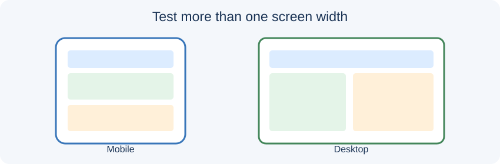

# Day 38 Lecture Notes — Style the Website and Make It Responsive

## Lesson purpose

Apply consistent CSS, readable typography, spacing, Flexbox or Grid where useful, and mobile-first responsive checks.

## 1. Keep the project achievable

The final project is an opportunity to combine skills already taught. It is not a competition to build the largest website. A clear single-page website with Home, About, Services or Courses, and Contact sections can meet the complete project requirement. Separate pages and extra features are optional extensions only.

## 2. Learning outcomes

- Organise CSS into readable sections.
- Apply consistent colours, typography, spacing, and component styles.
- Use Flexbox or Grid for a suitable layout.
- Use a media query when the layout needs a breakpoint.
- Test the page at mobile and desktop widths.

## 3. Core ideas

CSS controls presentation. Keep rules readable and consistent. Use a small colour palette, comfortable line spacing, and predictable spacing. Flexbox is useful for one-dimensional alignment; Grid is useful for rows and columns. Responsive design means content adapts to the available screen, not simply that the desktop page becomes smaller.

## 4. Instructor demonstration

Show how to link styles.css, set box-sizing, choose readable fonts and colours, create a centered container, style navigation and cards, and use Flexbox or Grid. Resize the browser and add a media query only when the layout needs it.

## 5. Practical workflow

1. Open styles.css and identify the existing starter styles before changing them.
2. Choose a small colour palette and readable font sizes.
3. Style the header, navigation, section spacing, buttons, cards, and footer consistently.
4. Use Flexbox or Grid for a section where it improves alignment.
5. Check for horizontal scrolling, cramped text, and buttons that are difficult to tap.
6. Test at a narrow mobile width and a wider desktop width using Chrome DevTools Device Mode.
7. Make one improvement based on the mobile test.

## 6. Common mistakes to watch for

- Students add optional features before finishing required work.
- File names or paths use different spelling or letter case.
- Navigation links do not match section IDs.
- Students test only on a desktop-sized screen.
- Students paste code without understanding or testing it.
- Students share passwords, tokens, private contact details, or other sensitive information.

## 7. Accessibility and privacy

Use descriptive link text, readable contrast, meaningful image alternatives, and buttons for actions. Keep interactive controls keyboard accessible. Use fictional project contact details. Never ask students to share passwords or access tokens. The starter contact form is a demonstration only unless a separate, approved service is configured.

## 8. References

- [MDN: Responsive design](https://developer.mozilla.org/en-US/docs/Learn_web_development/Core/CSS_layout/Responsive_Design)
- [MDN: Using media queries](https://developer.mozilla.org/en-US/docs/Web/CSS/CSS_media_queries/Using_media_queries)
- [Chrome DevTools: Device Mode](https://developer.chrome.com/docs/devtools/device-mode/)
