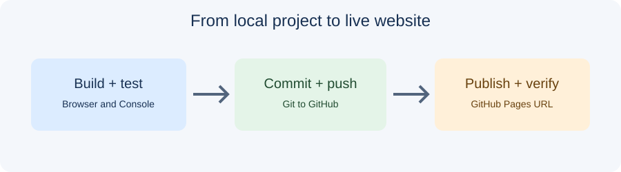

# Day 39 Lecture Notes — JavaScript, Testing, and Deployment

## Purpose
Complete the project with two understandable interactions, test it, and publish it.

## JavaScript interaction pattern
1. Select an element with a DOM method such as document.querySelector().
2. Add an event listener such as addEventListener("click", ...).
3. Change visible content or a class in response.
4. Test with mouse and keyboard.

Use patterns from Week 6. A mobile menu, FAQ show/hide, theme toggle, or client-side form feedback are suitable. Do not add a feature the student cannot explain.

## Testing checklist
- Navigation links lead to the correct section.
- Images load and have appropriate alternative text.
- Buttons perform the action described by their labels.
- No important JavaScript errors appear in the Console.
- The layout works at narrow and wide widths.
- The published site matches the latest saved project.

## Git publishing workflow
Run git status and inspect the changes. Stage only project files, commit with a clear message, and push to the correct GitHub repository. In repository settings, configure GitHub Pages for the branch and folder containing the website files. Open the supplied URL and test it.

## Static site limitation
GitHub Pages serves static HTML, CSS, JavaScript, and assets. It does not run a server or database. A sample form that displays a success message in JavaScript is only a demonstration; it does not deliver the message to anyone.

## Security
Never place passwords, personal access tokens, API keys, or private recovery information in source files, screenshots, or public repositories.

## References
- [GitHub Pages publishing](https://docs.github.com/en/pages/getting-started-with-github-pages/creating-a-github-pages-site)
- [GitHub and Git](https://docs.github.com/en/get-started/using-git/about-git)
- [Chrome Console](https://developer.chrome.com/docs/devtools/console/)
